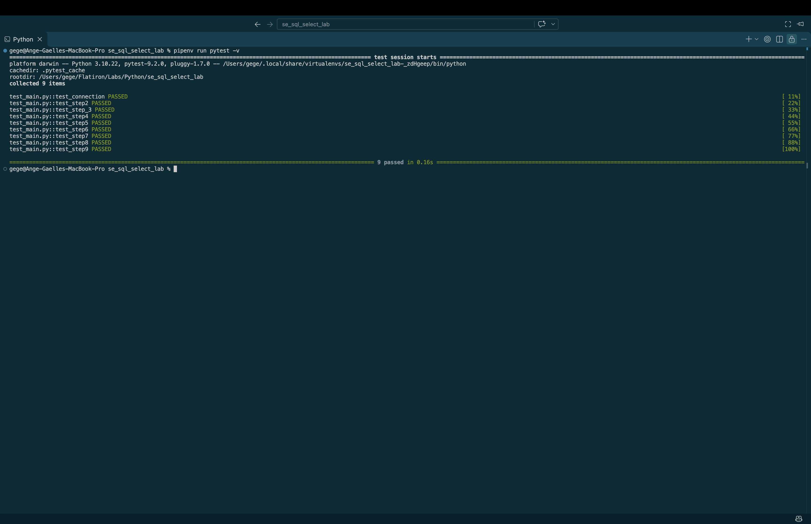

# Getting Started with Databases and SQL

## Description

The lab introduces working with SQLite databases using Python, SQL, and Pandas. It focuses on retrieving, filtering, transforming, and aggregating data from a sample database containing employee and order information.

The project demonstrates how to execute SQL queries in Python and store the results in Pandas DataFrames.

## Technologies Used

- Python 3.10
- SQLite3
- Pandas
- Pipenv
- Pytest
- SQL

## Project Structure

```text
se_sql_select_lab/
├── main.py
├── data.sqlite
├── test_main.py
├── Pipfile
├── Pipfile.lock
└── README.md
```

## Installation and Setup

### 1. Clone the Repository

```bash
git clone git@github.com:a-gbatie/se_sql_select_lab.git
cd se_sql_select_lab
```

### 2. Install Dependencies

This project uses Python 3.10 and Pipenv to manage its virtual environment and dependencies.

```bash
pipenv install --dev --python 3.10
```

### 3. Activate the Virtual Environment

```bash
pipenv shell
```

## Database Connection

The project uses Python's built-in `sqlite3` library to connect to the provided SQLite database.

```python
import sqlite3
import pandas as pd

conn = sqlite3.connect("data.sqlite")
```

SQL queries are executed using `pd.read_sql()`, which loads query results into Pandas DataFrames.

Example:

```python
employee_data = pd.read_sql("""
    SELECT *
    FROM employees
""", conn)
```

## Lab Objectives

### Step 1: Connect to the Database

Import SQLite3 and Pandas, then establish a connection to the `data.sqlite` database.

### Step 2: Select Specific Columns

Retrieve employee numbers and last names from the `employees` table.

Store the results in `df_first_five`.

### Step 3: Change Column Order

Retrieve employee last names followed by employee numbers.

Store the results in `df_five_reverse`.

### Step 4: Use SQL Aliases

Use the `AS` keyword to rename the employee number column to `ID`.

Store the results in `df_alias`.

### Step 5: Use CASE Statements

Use a SQL `CASE` expression to categorize employees based on their job titles.

Employees with the titles President, VP Sales, or VP Marketing are classified as `Executive`. All other employees are classified as `Not Executive`.

Store the results in `df_executive`.

### Step 6: Use String Functions

Calculate the length of each employee's last name using SQL string functions.

Return the result as `name_length`.

Store the results in `df_name_length`.

### Step 7: Extract Substrings

Extract the first two characters of each employee's job title using `SUBSTR()`.

Return the result as `short_title`.

Store the results in `df_short_title`.

### Step 8: Perform Numeric Calculations

Calculate the total amount for all orders using the `orderDetails` table.

Multiply `priceEach` by `quantityOrdered`, round each line total to the nearest whole number, and sum the results.

Store the result in `sum_total_price`.

### Step 9: Format Dates

Use SQLite's `STRFTIME()` function to extract the day, month, and year from the `orderDate` column.

Store the results in `df_day_month_year`.

## SQL Concepts Practiced

The lab covers several fundamental SQL concepts:

- `SELECT` and `FROM`
- Selecting specific columns
- Column ordering
- Column aliases using `AS`
- Conditional expressions using `CASE`
- String functions using `LENGTH()` and `SUBSTR()`
- Numeric calculations using `ROUND()` and `SUM()`
- Date formatting using `STRFTIME()`
- Loading SQL query results into Pandas DataFrames

## Running the Application

To execute the Python script:

```bash
pipenv run python main.py
```

## Running Tests

The project includes automated tests using Pytest.

Run all tests with:

```bash
pipenv run pytest -v
```

To stop at the first failing test:

```bash
pipenv run pytest -x
```

## Screenshot of Completed Tests


